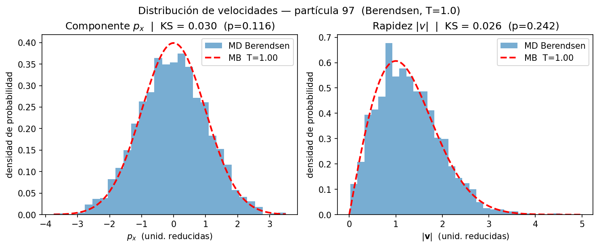
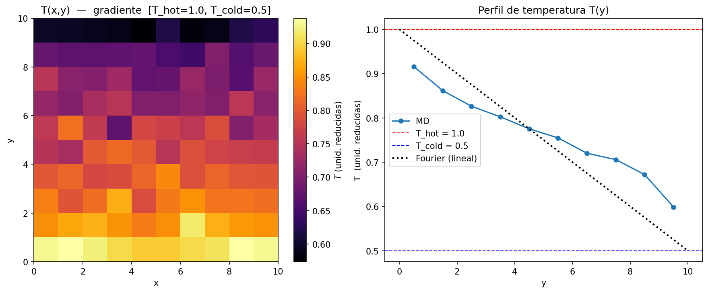

# 2D Lennard-Jones Fluid: Thermostats, Thermal Walls and Heat Conduction

Molecular Dynamics (MD) simulation of a two-dimensional Lennard-Jones fluid of $N$ particles in a square box of side $L$, written in Python.

Rather than a standard constant-energy (NVE) simulation, the project studies how temperature is imposed on the system. It compares a **global thermostat** with **stochastic thermal walls**, and then uses walls at different temperatures to drive the fluid into a **non-equilibrium steady state** with a temperature gradient.

## Highlights

- Velocity Verlet integrator (symplectic, second order) with a truncated and shifted Lennard-Jones potential
- Global temperature control with a Berendsen thermostat
- Stochastic thermal walls that sample the Maxwell-Boltzmann flux distribution on every collision
- Statistical validation of the steady state against the theoretical Maxwell-Boltzmann distribution
- 2D heatmap of the local temperature field $T(x, y)$ under an imposed temperature difference

## Physical model

All quantities are in reduced units: $\sigma = \varepsilon = m = k_B = 1$.

### Lennard-Jones potential

$$
V(r) = 4\varepsilon\left[\left(\frac{\sigma}{r}\right)^{12} - \left(\frac{\sigma}{r}\right)^{6}\right], \qquad r < r_{\text{cut}}
$$

The potential is shifted so that $V(r_{\text{cut}}) = 0$, which avoids an energy discontinuity at the cutoff.

### Velocity Verlet integrator

$$
\mathbf{r}(t+\Delta t) = \mathbf{r}(t) + \mathbf{v}(t)\,\Delta t + \tfrac{1}{2}\,\mathbf{a}(t)\,\Delta t^2
$$

$$
\mathbf{v}(t+\Delta t) = \mathbf{v}(t) + \tfrac{1}{2}\left[\mathbf{a}(t) + \mathbf{a}(t+\Delta t)\right]\Delta t
$$

### Berendsen thermostat

At each step, all velocities are rescaled by a common factor:

$$
\mathbf{v} \rightarrow \lambda\,\mathbf{v}, \qquad \lambda = \sqrt{1 + \frac{\Delta t}{\tau}\left(\frac{T_{\text{ref}}}{T_{\text{inst}}} - 1\right)}
$$

### Thermal walls

When a particle hits a wall at temperature $T$, it is re-emitted with a new random velocity drawn from the Maxwell-Boltzmann **flux** distribution:

- Tangential component: $v_t \sim \mathcal{N}(0, T)$
- Normal component (pointing into the box): $v_n \sim \text{Rayleigh}(\sqrt{T})$, sampled as $v_n = \sqrt{-2T \ln U}$ with $U \sim \mathcal{U}(0, 1)$

### Local temperature field

The box is divided into cells of area $\delta\Sigma = (L/n_x)\,(L/n_y)$. The local temperature $T(x, y)$ is obtained by averaging the kinetic energy of the particles in each cell over the production snapshots.

## Project phases

### 1. Global temperature control (Berendsen thermostat)

- Simulates the steady-state dynamics of the fluid at constant temperature.
- Compares the momentum distribution of a randomly selected particle with the theoretical Maxwell-Boltzmann distribution.
- Computes the mean potential energy per particle and its statistical dispersion.

### 2. Boundary thermalization (stochastic thermal walls)

- Replaces the global thermostat with a heat bath acting only at the walls, a more physically realistic model.
- Replaces elastic wall collisions with the stochastic re-emission process described above.
- Compares the resulting thermodynamic quantities with those of the Berendsen thermostat.

### 3. Heat conduction (non-equilibrium steady state)

- Sets the left wall at temperature $T$ and the right wall at $T/2$.
- Keeps the top and bottom walls adiabatic (perfectly elastic collisions, no heat exchange).
- Measures the local temperature field and visualizes the steady-state gradient as a 2D heatmap.

## Default parameters

| Parameter | Symbol | Value |
|-----------|--------|-------|
| Number of particles | $N$ | 100 |
| Box side | $L$ | 10.0 |
| Cutoff radius | $r_{\text{cut}}$ | 2.5 |
| Time step | $\Delta t$ | 0.005 |
| Target temperature | $T$ | 1.0 |
| Berendsen coupling time | $\tau$ | 0.1 |

The number density is $\rho = N / L^2$.

## Results





## Getting started

### Requirements

- Python 3.8+
- NumPy
- SciPy
- Matplotlib

### Installation and usage

```bash
git clone https://github.com/miguelrascon/leonard-jones-fluid.git
cd leonard-jones-fluid
pip install numpy scipy matplotlib
python main.py
```

## Context

Developed as a course project for the BSc in Physics at Universidad Autónoma de Madrid. 
Statistical Mechanics
2026 
